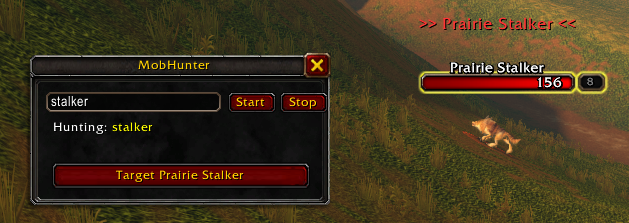
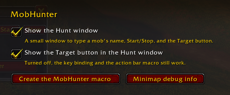
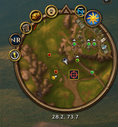

# MobHunter

Type `/mobhunt <mob name>` and MobHunter tells you when that mob comes into range.

| Command | What it does |
| --- | --- |
| `/mobhunt <name>` | Start hunting. Part of a name is enough: `/mobhunt pillager` finds "Defias Pillager". |
| `/mobhunt stop` | Stop hunting. |
| `/mobhunt` | Show what you're hunting. |
| `/mobhunt options` | Opens the options page (also under Options > AddOns > MobHunter): checkboxes for the Hunt window and for the Target button in it, plus create-macro and debug buttons. |
| `/mobhunt window` | Show or hide the Hunt window (a box, Start/Stop, status and the Target button; saved in `MobHunterDB`, hidden by default). |
| `/mobhunt button on\|off` | Show or hide the Target button in the Hunt window (saved in `MobHunterDB`; default on). |
| `/mobhunt macro` | Creates a "MobHunter" character macro (`/target <matched name>`, kept up to date) to drag onto an action bar. `/click MobHunterTargetButton` was tried first and did nothing in the client. |
| `/mobhunt debug` | Opens a copyable window with what the minimap probe can and can't do on this client (also saved as `lastDebug` in the SavedVariables file after `/reload`). |
| `/mobhunt target` | Explains that a slash command can't target (protected) and points to `/mobhunt macro`. |

When a match shows up you get a **sound**, a **chat and on-screen message**, a red **marker above the mob's
nameplate**, and, if the mob is one of your minimap tracking dots, **MobHunter's icon drawn over its dot on the minimap**. A **Target
button** appears on screen only while a matching mob is in targeting range (inside the Hunt window; drag the window with the left mouse button) and can be bound to a key under
**Options > Keybindings > AddOns > MobHunter**. Pressing it runs `/target <the matched mob's full name>` (e.g. `/target Prairie Stalker` after `/mobhunt stalker`).

*Real client, Forever: hunting "stalker". The Hunt window shows the status and the Target button, and the red marker sits above the mob.*

*Real client, Forever: Options > AddOns > MobHunter.*

*Real client, Forever: a hunted mob among the tracking dots, with the MobHunter icon over its dot.*

## What it looks at

1. **Mobs in range.** Enemy nameplates the game is already showing (turn on enemy nameplates, or MobHunter
   will say so). Each mob alerts once while it stays in range.
2. **Minimap tracking dots**, when you are tracking something (Find Herbs, Track Beasts, ...). The game has
   no call that lists minimap blips, so MobHunter does what the NodeSight addon does: it moves the
   minimap's soft cursor over a grid of points and reads the tooltip the game would show there. A dot
   whose tooltip names the hunted mob gets the icon. The dot itself can't be hidden by an addon, so the icon (a child frame of the minimap,
   a pixel larger than a dot) is drawn on top of it.

## Why it doesn't target the mob by itself

`TargetUnit` is a protected function: addon code isn't allowed to call it, and Blizzard's design (the
secure-execution model) lets addons start a protected action only when the player presses something. So
MobHunter alerts you and gives you a one-press way to target. The button's macro text can only be changed
out of combat; if you start a hunt in combat it is armed when combat ends. The keybind works in combat once
it's armed. `/target <name>` picks the nearest match, which isn't necessarily the mob that triggered the
alert.

## Terms of service

This is a read of Blizzard's published rules, not legal advice, and I (the author's assistant) could not
read the current Terms of Use or EULA text. What I did read:

- Blizzard's **UI Add-On Development Policy** (forum thread 24534). Its eight rules cover: free of charge,
  no hidden code, no negative effect on performance or other players, no advertising or donation requests,
  content rating, compliance with the Terms of Use and EULA, and Blizzard's right to disable add-on
  functionality. Nothing in it names automation, targeting or minimap information.
- Blizzard's long-standing design: addons may display information and may start protected actions
  (targeting, casting) only through player input. Blizzard has disabled addons that automate play, such as
  one-button combat. That is why MobHunter does not auto-target.

How MobHunter fits: it only reads what the client already shows (nameplates and minimap tooltips), it does
not act for you, and a targeting action needs your own key press. The remaining risks are (a) minimap
probing runs many tooltip lookups every second, which is a performance question under rule 3, and (b) the
minimap technique is a workaround rather than a documented API, so Blizzard could restrict it, as it has
done for other information with "secret values". NodeSight, which uses the same technique, is published for
WoW Forever, which is evidence it is tolerated but not a guarantee. Re-check the policy and the in-game
EULA before publishing.

## Not verified on a real client

- `Minimap:UpdateMouseoverAtPoint` and `C_TooltipInfo.GetMinimapMouseover`: the second is on the Warcraft
  Wiki for Forever 1.60.1; the first came from NodeSight's source and has no wiki page I could read. The
  coordinates follow NodeSight's call (screen coordinates: `(left + x) * scale`); that fixed an earlier guess that returned empty tooltips.
- `Probe.HIT_RADIUS` (15 minimap units): how far from a dot's centre the minimap tooltip still names it. NodeSight starts at 15 and adapts it between 11 and 24; `/mobhunt debug` output fits that, but it is not measured. `Probe.Fit` uses it to turn overlapping hits into one dot each, trying smaller radii if 15 explains nothing.
- That tracked creatures list their name on a tooltip line, and that probing works in combat.
- That nameplate unit names are readable (they may be "secret values" in some situations; MobHunter treats
  an unreadable name as "no match").
- Anchoring a marker to a nameplate, the sound ID, and the key binding file (`Bindings.xml`).
- Performance of the minimap probe (about 1,000 tooltip lookups a second at the default grid).

## Development

`lua tests/run.lua` covers the matching logic, the minimap probe against a fake minimap, and that
`MobHunter.lua` loads and runs a hunt against a permissive fake client.
