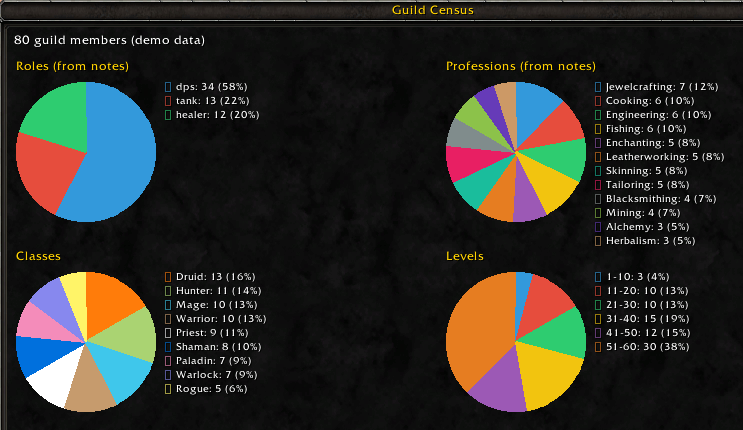
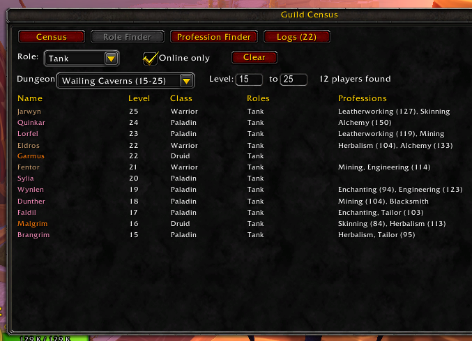
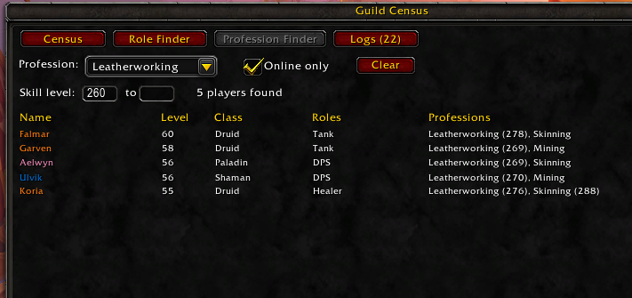
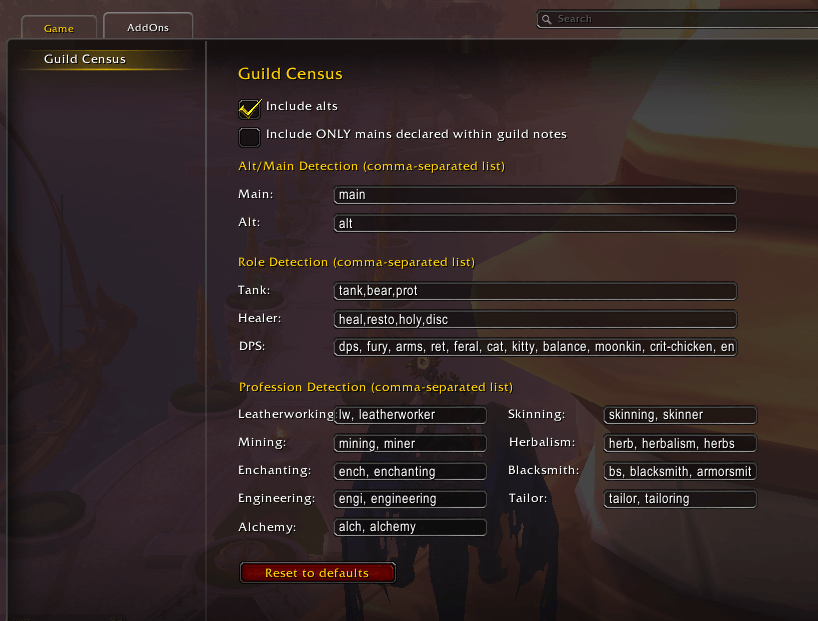

# Guild Census

Guild Census builds pie charts of your guild roster so you can see its makeup at a glance.
It targets WoW Forever and also builds for Retail. Type `/gcensus` to open it.

## What it shows

- **Roles:** tanks, healers and DPS, read from your members' guild notes.
- **Professions:** read from the same notes.
- **Classes:** one slice per class, in class colours.
- **Levels:** how many members fall in each 10-level range.

## Features

- **Role Finder and Profession Finder:** search the guild for a tank for a dungeon, or for a crafter
  with a given skill level. See [Finder](#finder).
- **Editable keyword lists:** the whole-word keywords used to spot roles, professions, and mains/alts are
  editable in the settings panel.
- **Alts and mains:** leave out alts, or count only members whose note says they're a main.
- **Pure-DPS classes:** warlocks, hunters, mages and rogues are always counted as DPS.
- **Logs tab:** lists contradictory notes, with each player's note, so you can tidy the notes or
  tune your keywords. Logged notes are still counted in the charts.
- **Demo mode:** `/gcensus demo` shows a fake 500-member guild, handy if you're not in a guild. It's
  built so every Finder filter has results (each dungeon has tanks, healers, DPS and online players;
  every profession is spread across roles and levels), with declared mains and alts, a few
  deliberately contradictory notes for the Logs tab, and enough members to hit the Finder's row cap.

## Install

Every push to `main` builds two zips, available as artifacts on the repository's **Actions** tab:

| Artifact | Client | Interface |
| --- | --- | --- |
| `GuildCensus-Forever-<n>` | WoW Forever | `16001` |
| `GuildCensus-Retail-<n>` | Retail | `120105` |

Download the one for your client, unzip it, and put the `GuildCensus` folder in your AddOns folder
(`.../_retail_/Interface/AddOns/`, or `_classic_beta_` for the Forever beta), then restart the client or
`/reload`. If the game still lists the addon as out of date, tick **Load out of date AddOns** in the
AddOns list. Check your client's number with `/dump select(4, GetBuildInfo())`.

To install from a clone instead, copy the `GuildCensus/` folder (not the repo root) into AddOns. The
repository's TOC uses the Forever interface number.

## Usage

| Command | Does |
| --- | --- |
| `/gcensus` (or `/guildcensus`) | Open or close the census window |
| `/gcensus roles` (or `finder`) | Open the window on the Role Finder tab |
| `/gcensus professions` | Open the window on the Profession Finder tab |
| `/gcensus logs` | Open the window on the Logs tab |
| `/gcensus config` | Open the settings panel |
| `/gcensus demo` | Toggle a 500-member fake roster |

The window has four tabs: **Census** (the four pie charts), **Role Finder**, **Profession Finder** and
**Logs**. The Logs tab
shows how many conflicts were found, for example `Logs (27)`.

## Finder

Two tabs search the guild for people who fit a need. Both update as you change a control, both have an
**Online only** checkbox (limits the search to members who are online right now), and both have a
**Clear** button that puts every control back to its default.

**Role Finder** (`/gcensus roles`) is for filling a group, for example a tank for a level 15-25 dungeon:

- **Role:** a dropdown with Any, Tank, Healer or DPS.
- **Dungeon:** pick a dungeon to fill in its level range, or choose **Custom** and type a range.
  Editing a level by hand switches the dungeon back to Custom. Ranges come from Wowhead's Forever
  dungeon guide (beta data, so they may change).
- **Level:** a minimum and/or maximum level, inclusive; leave either empty for no limit.

*Online tanks for Wailing Caverns (levels 15-25): picking the dungeon filled in the level range.*

**Profession Finder** (`/gcensus professions`) is for finding a crafter. It only asks for a profession,
because player levels and roles don't matter when you want someone's profession. **Any profession**
lists everyone with at least one profession. If players write their skill in their note, you can also
filter by a **skill level** range (for example 225 to 300).

Skill levels are read from the number written right after a profession keyword: `LW 260`, `BS: 310`,
`Mining (300)` and `Alch-225` all work, and `LW 260/300` reads as 260. With a profession selected, that
profession's skill must be in the range; with **Any profession**, any of the member's professions may
be. Members who don't write a skill are left out as soon as you type a skill bound, since their skill
is unknown. Skills show in the results next to the profession, for example `Leatherworking (260)`.

*Online leatherworkers with a written skill of 260 or higher. The maximum skill is left empty, so there is
no upper limit.*

Each row shows the player's name (in class colour), level, class, detected roles and professions
(with their skill, when written), highest level first. Very large guilds show the first 300 matches.

Both use exactly the same detection and settings as the charts, so warlocks, hunters, mages and rogues
always count as DPS, and your alts/mains choices apply. Members with conflicts in the Logs tab are still
listed.

## Settings

`/gcensus config` opens the settings panel, which is also under Options > AddOns.

- **Include alts** and **Include ONLY mains declared within guild notes** checkboxes. When both
  apply, a member must pass the alts checkbox and also declare a main.
- **Alt/Main, Role and Profession detection:** comma-separated keyword lists. Changes apply
  immediately, and **Reset to defaults** restores the originals.

### How detection works

Detection reads each member's **public** guild note. A keyword matches only as a **whole word**, ignoring
case: it must not touch a letter on either side. So `bs` matches "BS 300" and "herbs, bs" but not the
"bs" inside "herbs", and `ret` matches "Ret" but not "secret" or "return". Digits and punctuation count as
a boundary, so `LW260`, `herb-251` and `(tank)` all match.

That means a keyword does **not** match longer spellings: `heal` won't match "healer". The defaults
therefore list both the abbreviations players write (`lw`, `bs`, `heal`, `ench`, ...) and the full words
(`leatherworking`, `blacksmithing`, `healer`, ...). If you edit a list, add the spellings you want matched.
An emptied box matches nothing.

Default keywords:

| Detection | Defaults |
| --- | --- |
| Main | `main, mains` |
| Alt | `alt, alts` |
| Tank | `tank, tanks, tanking, bear, prot, protection` |
| Healer | `heal, heals, healer, healers, healing, resto, restoration, holy, disc, discipline` |
| DPS | `dps, damage, fury, arms, ret, retribution, feral, cat, kitty, balance, moonkin, crit-chicken, enh, enhancement, ele, enhance, elemental, shadow, shockadin` |
| Leatherworking | `lw, leatherworking, leatherworker` |
| Skinning | `skinning, skinner` |
| Mining | `mining, miner` |
| Herbalism | `herb, herbs, herbalism, herbalist` |
| Enchanting | `ench, enchanting, enchanter` |
| Blacksmith | `bs, blacksmith, blacksmithing, armorsmith, armorsmithing, weaponsmith, weaponsmithing` |
| Engineering | `engi, engineer, engineering` |
| Tailor | `tailor, tailoring` |
| Alchemy | `alch, alchemy, alchemist` |

When the defaults change between versions, a saved list that still equals an older default is upgraded
automatically; a list you've edited is never touched.

## Census logs

The Logs tab lists notes whose detection results contradict each other. Each entry shows the player,
what's wrong, the keyword that matched, and the note itself. A note is logged when it:

- is detected as both a main and an alt;
- matches more than two professions;
- matches a role the player's class can't fill (for example a mage matching "healer").

Matching all three roles is not a conflict, since some classes can do all three.

The log is informational only. Logged members are still counted in every chart, and conflicts are
reported for every guild member regardless of the alts/mains filters.

## Development

- **Tests:** `lua tests/run.lua` (Lua 5.1) runs note-parsing and census tests plus headless UI tests
  against a strict WoW widget stub (`tests/wow_stub.lua`). The stub checks logic and widget-method
  names; it does not check rendering or Forever API compatibility.
- **Builds:** `.github/workflows/build.yml` publishes the Forever and Retail artifacts and keeps the
  newest 5 of each.
- **Icon:** `tools/make_icon.py` regenerates `GuildCensus/icon.tga`. Add `--size N --jpeg PATH` (needs
  Pillow) for a larger JPEG; the repo's copies are in `assets/`.
- **Client notes:** WoW runs Lua 5.1; use `C_Spell` / `C_Item` rather than removed globals, don't
  register `COMBAT_LOG_EVENT_UNFILTERED`, and guard values with `issecretvalue`.
- **Learning notes:** [docs/LEARNING.md](docs/LEARNING.md) lists where the WoW APIs and Forever details
  came from, which source was actually read, which API is used where, and what is still unverified.

## License

[MIT](LICENSE). The build artifacts include the license file.
